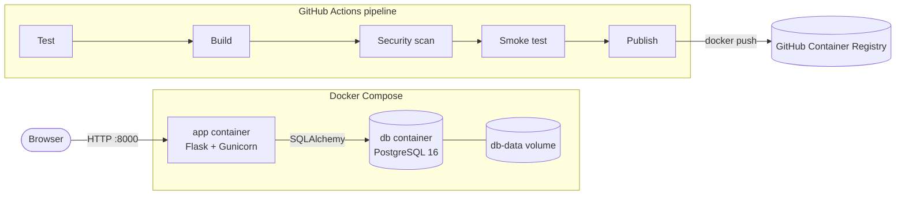

# Containerized Library Management System with Automated CI/CD

A small library management web app built with Flask and PostgreSQL. It runs in Docker containers, and a GitHub Actions pipeline tests, builds, scans and publishes it automatically on every change.

## Features

- **Books:** add, list, search by title or author, delete
- **Members:** add, list
- **Issue and return:** issue a book to a member and return it. A book that is already issued can't be issued again until it is returned.
- **Dashboard:** total books, members and issued books, plus a list of the books currently issued
- **Health check:** `GET /health` returns `{"status": "ok"}` after checking the database connection

On first start, an empty database is filled with a few sample books and members.

## Architecture



| Part | Technology |
| --- | --- |
| Web app | Python 3.12, Flask, Jinja templates, plain CSS |
| Database access | Flask-SQLAlchemy (PostgreSQL in Docker, SQLite for tests) |
| App server | Gunicorn on port 8000 |
| Containers | Docker, Docker Compose |
| CI/CD | GitHub Actions, Trivy, GitHub Container Registry (ghcr.io) |

## Project structure

```
library/
  __init__.py        app factory, database setup, sample data
  models.py          Book and Member tables, issue and return rules
  views.py           pages, forms and /health
  templates/         HTML pages
  static/style.css
tests/test_app.py    pytest tests
Dockerfile
docker-compose.yml
.github/workflows/ci-cd.yml
```

## Run it

You need [Docker Desktop](https://www.docker.com/products/docker-desktop/) installed and running.

```bash
docker compose up --build
```

Open http://localhost:8000. Press Ctrl+C to stop.

The default database credentials are set in `docker-compose.yml`. To change them, copy `.env.example` to `.env` and edit the values. To delete the database and start fresh, run `docker compose down -v`.

## Run the tests

The tests use an in-memory SQLite database, so no Docker or PostgreSQL is needed.

```bash
python3 -m venv .venv
source .venv/bin/activate
pip install -r requirements-dev.txt
pytest -v
```

## CI/CD pipeline

The pipeline in `.github/workflows/ci-cd.yml` runs on every push to `main` and on every pull request to `main`. Each stage starts only if the previous one passed.

| Stage | What it does |
| --- | --- |
| 1. Test | Installs the dependencies and runs the pytest tests. |
| 2. Build | Builds the Docker image and saves it as a file so the next stages use the exact same image. |
| 3. Security scan | Scans the image with Trivy. The pipeline fails if it finds a CRITICAL vulnerability that has a fix available. |
| 4. Smoke test | Starts the app and database with Docker Compose, waits until `/health` passes, then shuts everything down. |
| 5. Publish | Pushes to `main` only: uploads the image to GitHub Container Registry, tagged `latest` and with the commit SHA. |

The pipeline only uses the built-in `GITHUB_TOKEN`, so no secrets or outside accounts need to be set up. The image name comes from the repository name, so the same workflow works in any repository. After a successful run on `main`, the image appears under **Packages** on the repository page:

```bash
docker pull ghcr.io/<owner>/<repository>:latest
```
