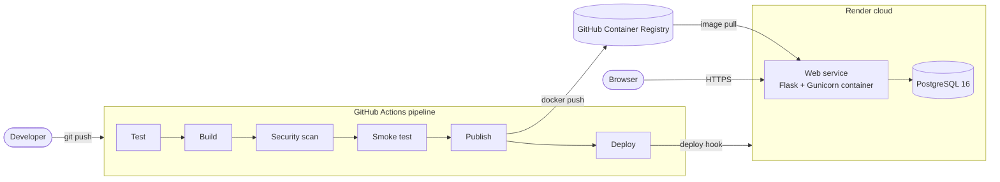

# Containerized Library Management System with Automated CI/CD

A library management web app built with Flask and PostgreSQL. It runs in Docker containers, and a GitHub Actions pipeline tests, builds, scans, publishes and deploys it to the cloud automatically on every change.

## Features

- **Books:** 256 real books across 12 genres. Browse them as cards with generated covers, search by title or author, filter by genre and status (available, issued, overdue), add and delete books.
- **Members:** list members with how many books they have on loan and how many are overdue, and add new members.
- **Issue and return:** issue a book to a member for 14 days and return it. A book that is already issued can't be issued again until it is returned.
- **Overdue tracking:** every loan shows its due date, and loans past the due date are marked overdue.
- **Dashboard:** totals for books, available, issued, overdue and members, a chart of books by genre, and the loans that need attention first.
- **Health check:** `GET /health` checks the database connection and returns `{"status": "ok", "version": "<commit>"}`.
- **Works on phones, and has a dark mode** that follows the device setting.

On first start, an empty database is filled with the sample books, 30 members and 30 loans, some of them overdue.

## Architecture



| Part | Technology |
| --- | --- |
| Web app | Python 3.12, Flask, Jinja templates, plain CSS |
| Database access | Flask-SQLAlchemy (PostgreSQL in Docker and on Render, SQLite for tests) |
| App server | Gunicorn on port 8000 |
| Containers | Docker, Docker Compose |
| CI/CD | GitHub Actions, Trivy, GitHub Container Registry (ghcr.io) |
| Hosting | Render web service and Render PostgreSQL, defined in `render.yaml` |

## Project structure

```
library/
  __init__.py        app factory, database setup, sample data
  models.py          Book and Member tables, issue, return and overdue rules
  views.py           pages, forms and /health
  data/books.csv     the sample books
  templates/         HTML pages
  static/style.css
tests/test_app.py    pytest tests
Dockerfile
docker-compose.yml   local stack: app + PostgreSQL
render.yaml          cloud stack on Render: web service + PostgreSQL
.github/workflows/ci-cd.yml
```

## Run it on your computer

You need [Docker Desktop](https://www.docker.com/products/docker-desktop/) installed and running.

```bash
docker compose up --build
```

Open http://localhost:8000. Press Ctrl+C to stop.

The default database credentials are set in `docker-compose.yml`. To change them, copy `.env.example` to `.env` and edit the values. To delete the database and start fresh, run `docker compose down -v`.

## Run the tests

The tests use an in-memory SQLite database, so no Docker or PostgreSQL is needed.

```bash
python3 -m venv .venv
source .venv/bin/activate
pip install -r requirements-dev.txt
pytest -v
```

## CI/CD pipeline

The pipeline in `.github/workflows/ci-cd.yml` runs on every push to `main` and on every pull request to `main`. Each stage starts only if the previous one passed, so a change that fails a test or the security scan never reaches users.

| Stage | What it does |
| --- | --- |
| 1. Test | Installs the dependencies and runs the pytest tests. |
| 2. Build | Builds the Docker image, stamped with the commit SHA, and saves it as a file so the next stages use the exact same image. |
| 3. Security scan | Scans the image with Trivy. The pipeline fails if it finds a CRITICAL vulnerability that has a fix available. |
| 4. Smoke test | Starts the app and database with Docker Compose, waits until `/health` passes, then shuts everything down. |
| 5. Publish | Pushes to `main` only: uploads the image to GitHub Container Registry, tagged `latest` and with the commit SHA. |
| 6. Deploy | Pushes to `main` only: tells Render to run the image with this commit's SHA. Skipped with a notice when the `RENDER_DEPLOY_HOOK_URL` secret is not set. |

Publishing uses the built-in `GITHUB_TOKEN`, and the image name comes from the repository name, so the same workflow works in any repository.

## Deployment on Render

`render.yaml` is a Render Blueprint: it describes the cloud setup as code, the same idea as Infrastructure as Code. It defines a free web service that runs the published Docker image, a free PostgreSQL 16 database, the health check path, and the environment variables. Render creates everything from this file.

One-time setup:

1. On the package page of the published image on GitHub, set the visibility to **Public** so Render can pull it.
2. In Render, choose **New → Blueprint**, select this repository, and apply it.
3. In the new web service, open **Settings → Deploy Hook** and copy the URL.
4. In this GitHub repository, open **Settings → Secrets and variables → Actions** and add it as a secret named `RENDER_DEPLOY_HOOK_URL`.

From then on, every push to `main` that passes all stages is deployed automatically. The page footer and `/health` show the commit that is running.

Free plan limits: the web service sleeps after 15 minutes without visitors and takes about a minute to wake up, and a free database expires after 30 days. A new, empty database is filled with the sample data automatically on the next start.
